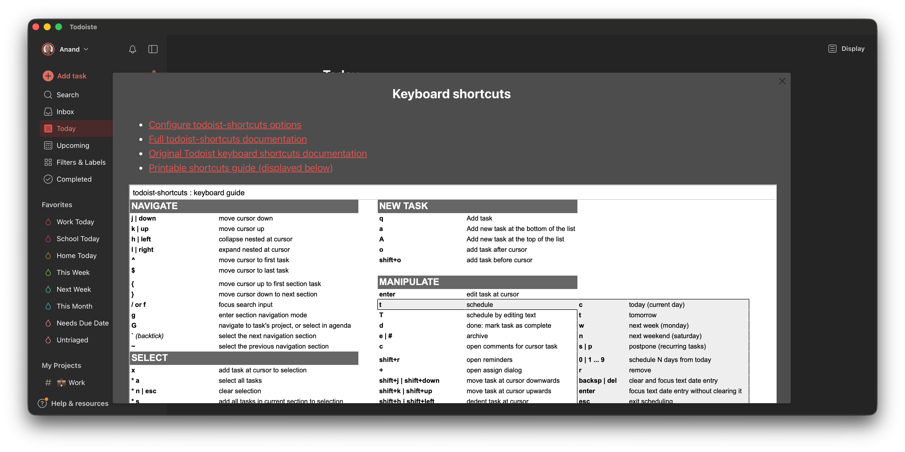

# Todoiste

A native macOS app for [Todoist](https://todoist.com) with full keyboard shortcuts, powered by [todoist-shortcuts](https://github.com/mgsloan/todoist-shortcuts).

Todoiste wraps Todoist's web app in a lightweight WKWebView and injects the todoist-shortcuts extension as plain JavaScript — no browser required. You get a real Mac app (Dock icon, Cmd+Tab, native window management) with the full suite of Gmail/vim-inspired keyboard shortcuts.



## Why?

Todoist's official Mac app doesn't support the todoist-shortcuts extension. Using it in Chrome works, but the tab lives among dozens of others and doesn't feel like a standalone app. Browser-to-app wrappers like Coherence X get close but have quirks. Todoiste provides a small native wrapper with the extension’s keyboard shortcuts.

## Installing

Download the latest `Todoiste.dmg` from
[Releases](https://github.com/anandman/Todoiste/releases), open it, and drag
Todoiste to Applications.

Releases are signed with a Developer ID, notarized by Apple, and include a
stapled notarization ticket. Both Apple Silicon and Intel Macs are supported.

To build and install from source instead:

```bash
xcodegen generate   # see Building below if you don't have xcodegen
xcodebuild -project Todoiste.xcodeproj -scheme Todoiste -configuration Release \
  -derivedDataPath build build
rm -rf /Applications/Todoiste.app
ditto build/Build/Products/Release/Todoiste.app /Applications/Todoiste.app
```

`/Applications/Todoiste.app` is a copy, so rerun those last two lines after any
change to the Swift source — building in Xcode alone will not update it.

## Building

### Prerequisites

- macOS 14+ (Sonoma or later)
- Xcode 15+
- [xcodegen](https://github.com/yonaskolb/XcodeGen) (optional but recommended)

### With xcodegen

```bash
brew install xcodegen
cd Todoiste
xcodegen generate
open Todoiste.xcodeproj
# Cmd+R to build and run
```

Or from the command line:

```bash
xcodegen generate
xcodebuild -project Todoiste.xcodeproj -scheme Todoiste -configuration Debug \
  -derivedDataPath build build
open build/Build/Products/Debug/Todoiste.app
```

### Without xcodegen (building from scratch, not from a clone)

The `.xcodeproj` is gitignored since it's generated by xcodegen. If you don't want to install xcodegen, you can recreate the project manually:

1. Open Xcode → File → New → Project → macOS → App (SwiftUI, Swift)
2. Add all Swift sources under `Todoiste/` to the target
3. Add `Todoiste/Resources/Shortcuts` as a **folder reference** copied into Resources, preserving its contents and paths. Add `bootstrap.js` and `settings-storage-adapter.js` as individual resources
4. Add `Todoiste/Assets.xcassets` to the target (for app icon/assets)
5. Use `Todoiste.entitlements` as the entitlements file
6. Build and run

## How It Works

The Chrome extension injects two scripts into `todoist.com/app`: [mousetrap.js](https://github.com/mgsloan/mousetrap) (keyboard event library) and todoist-shortcuts.js (the shortcut logic). Neither uses any Chrome-specific APIs — they're pure DOM manipulation.

Todoiste does the same injection natively via `WKWebView`:

1. Load Todoist in-app with persistent login
2. Inject shortcut scripts + native settings options
3. Keep OAuth flows in-app; open external links in default browser
4. Bridge web notifications to native macOS notifications

The main web view’s navigation, script injection, and notification bridge live in
`Todoiste/WebView.swift`. A separate local web view hosts the extension’s own
settings page.

## Keyboard Shortcuts

See the full shortcut reference at [mgsloan/todoist-shortcuts](https://github.com/mgsloan/todoist-shortcuts#keyboard-shortcuts). Press `?` inside the app to open the shortcuts help modal.

## Settings

Open **Todoiste → Settings…** (Cmd+,) or follow the settings link in the shortcut
help. Todoiste displays the bundled extension’s original settings page, so its
labels, controls, and new options follow the vendored version. Preferences are
saved locally for Todoiste; Chrome sync settings are separate. Existing native
mouse and cursor preferences migrate automatically. Use **Reload Todoiste** after
saving to apply changes to the main window. If you close Settings with saved
changes still unapplied, a reminder offers **Reload Now** or **Later**.

The host adapts the extension’s storage API and passes its full options JSON to
the shortcut runtime. New options do not require matching Swift controls while
the extension keeps the supported storage and DOM transport contracts. Changes
to those contracts stop automated publication for integration review.

## Keeping Up with Upstream

The complete extension source in `Todoiste/Resources/Shortcuts/` is vendored verbatim from [mgsloan/todoist-shortcuts](https://github.com/mgsloan/todoist-shortcuts). To prepare the version published in the Chrome Web Store:

```bash
./scripts/update-shortcuts.sh
```

This pins the matching upstream tag to a commit, checks JavaScript syntax, local
settings resources and supported APIs, updates `upstream.json`, and bumps Todoiste's patch and build
numbers. Review the diff and rebuild. Native-only releases must keep the two
Todoiste version fields in `upstream.json` in sync with `project.yml`.

The [Store monitor](.github/workflows/check-upstream.yml) runs every six hours.
When the Store publishes a newer version with a matching upstream tag and
manifest, it prepares the update and runs the [signed release workflow](.github/workflows/release.yml).
After a universal build, settings UI/storage tests in WebKit, startup smoke test,
signature/resource checks, Apple
notarization, stapling, and Gatekeeper verification, it commits the update and
publishes the verified DMG automatically. It never replaces a public release.
Missing tags, ambiguous Store data, unsupported storage/resource/DOM contracts,
and failed checks stop publication; failed runs can be retried without another version bump.
The Store listing is polled directly; its HTML can change, in which case the
monitor fails until its parser is reviewed. Authenticated Todoist interactions
still need a manual smoke test when integration behavior changes.

Signing secrets belong to this repository's `release` environment, restricted to
`main`: `DEVELOPER_ID_P12_BASE64`, `DEVELOPER_ID_P12_PASSWORD`,
`NOTARY_API_KEY_BASE64`, `NOTARY_API_KEY_ID`, and `NOTARY_API_ISSUER_ID`.
They are imported into a temporary runner keychain and removed after the build.
`STORE_RELEASES_ENABLED=true` enables scheduled publication; set it to `false`
to pause the monitor. No personal access token is required.

For an unpublished signed/notarized validation build, run **Signed release** in
Actions with `publish=false` (the default). Its verified DMG is retained as an
Actions artifact for seven days. `publish=true` publishes only a pending release.
The local signed/notarized flow remains available via `./scripts/release.sh`.

## Verifying the Settings Host

On macOS with Xcode command-line tools and Node.js:

```bash
python3 -m unittest discover -s tests -p 'test_*.py'
./scripts/test-settings-host.sh
```

These checks exercise the storage adapter, preference migration, arbitrary JSON,
the actual bundled settings page, persistence after a control change and reload,
native dialogs, and bridge isolation. They do not require a Todoist login.

## Credits

Todoiste was created by [Anand Mandapati](https://github.com/anandman).

The keyboard shortcut logic is entirely the work of [@mgsloan](https://github.com/mgsloan) via [todoist-shortcuts](https://github.com/mgsloan/todoist-shortcuts). Todoiste is just a thin native wrapper around it.

The vendored `mousetrap.js` is from mgsloan's [fork](https://github.com/mgsloan/mousetrap) of the original [Mousetrap](https://craig.is/killing/mice) library by Craig Campbell.

## Unofficial / No Affiliation

This project is an unofficial personal wrapper and is not affiliated with, endorsed by, or sponsored by [Doist](https://doist.com).
[Todoist](https://todoist.com) is a trademark of [Doist](https://doist.com).

## License

MIT — see [LICENSE](LICENSE).

The vendored todoist-shortcuts scripts are copyright their respective authors and are distributed under their own license. See the [todoist-shortcuts repository](https://github.com/mgsloan/todoist-shortcuts) for details.
